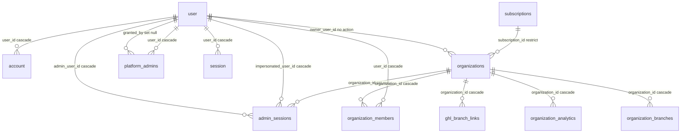
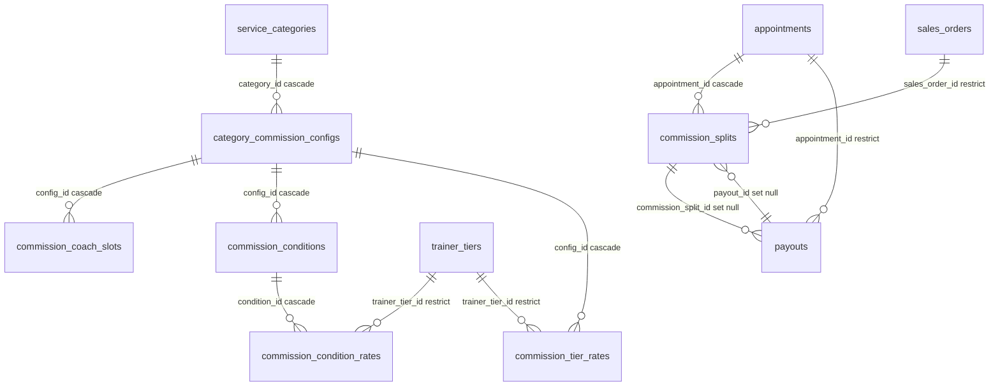
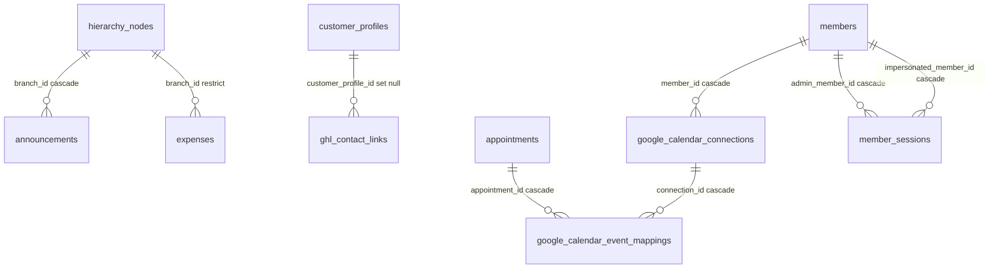
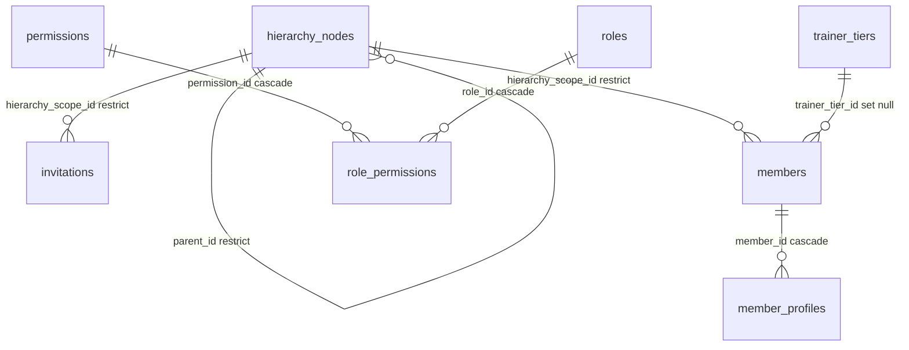
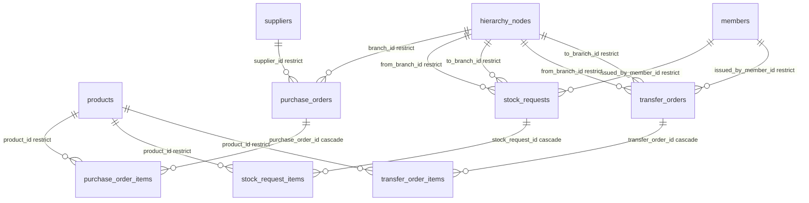
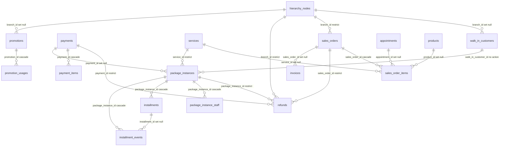
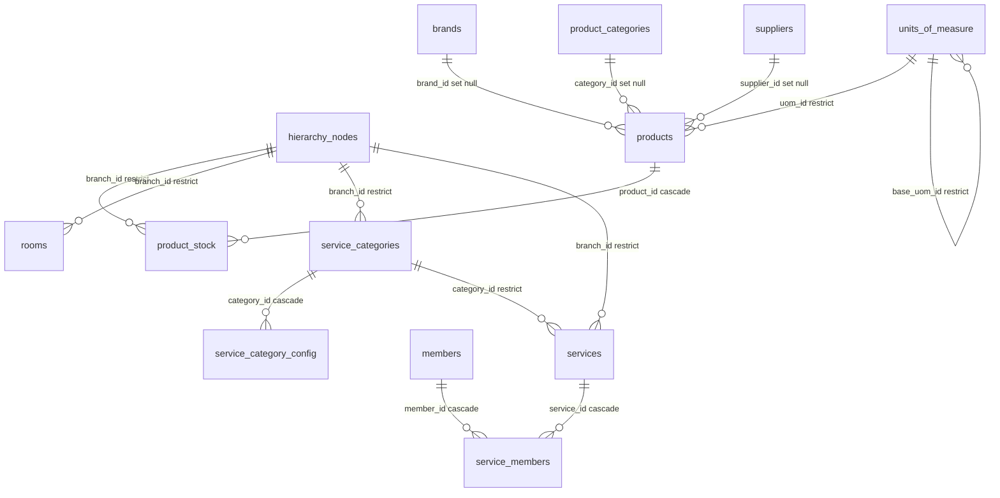

# Schema ERD (auto-generated)

> **Do not edit by hand.** Regenerate with `bun scripts/gen-erd.ts`.

Generated: 2026-05-06T02:42:05.235Z
Tenant org: Test Fitness Franchise
Control panel: 12 tables, 14 FKs
Tenant: 76 tables, 104 FKs

## Control Panel

Tables: account, admin_sessions, ghl_branch_links, organization_analytics, organization_branches, organization_members, organizations, platform_admins, session, subscriptions, user, verification

## Tenant — by domain

### Appointments & Scheduling

**Tables**: appointment_clients, appointment_staff, appointments, check_ins, class_slots, coach_intake_availability, coach_intake_exceptions, member_category_buffer_overrides, member_service_buffer_overrides, preferred_times, recurrence_rules, trainer_availability, waitlist_entries

```mermaid
erDiagram
  appointments ||--o{ appointment_clients : "appointment_id cascade"
  package_instances ||--o{ appointment_clients : "package_instance_id set null"
  walk_in_customers ||--o{ appointment_clients : "walk_in_customer_id no action"
  appointments ||--o{ appointment_staff : "appointment_id cascade"
  hierarchy_nodes ||--o{ appointments : "branch_id restrict"
  class_slots ||--o{ appointments : "class_slot_id set null"
  package_instances ||--o{ appointments : "package_instance_id set null"
  appointments ||--o{ appointments : "recurring_parent_id cascade"
  rooms ||--o{ appointments : "room_id set null"
  sales_orders ||--o{ appointments : "sales_order_id set null"
  services ||--o{ appointments : "service_id set null"
  members ||--o{ appointments : "trainer_id set null"
  appointment_clients ||--o{ check_ins : "appointment_client_id set null"
  hierarchy_nodes ||--o{ check_ins : "branch_id restrict"
  hierarchy_nodes ||--o{ class_slots : "branch_id restrict"
  members ||--o{ class_slots : "instructor_id set null"
  services ||--o{ class_slots : "service_id cascade"
  members ||--o{ coach_intake_availability : "trainer_id cascade"
  members ||--o{ coach_intake_exceptions : "trainer_id cascade"
  service_categories ||--o{ member_category_buffer_overrides : "category_id cascade"
  members ||--o{ member_category_buffer_overrides : "member_id cascade"
  members ||--o{ member_service_buffer_overrides : "member_id cascade"
  services ||--o{ member_service_buffer_overrides : "service_id cascade"
  package_instances ||--o{ preferred_times : "package_instance_id cascade"
  appointments ||--o{ recurrence_rules : "appointment_id cascade"
  members ||--o{ trainer_availability : "trainer_id cascade"
  appointments ||--o{ waitlist_entries : "appointment_id set null"
  class_slots ||--o{ waitlist_entries : "class_slot_id cascade"
```

### Commission & Payouts

**Tables**: category_commission_configs, commission_coach_slots, commission_condition_rates, commission_conditions, commission_splits, commission_tier_rates, partner_stripe_accounts, payouts

### Engagement & Integrations

**Tables**: announcements, audit_logs, dashboard_snapshots, expenses, ghl_contact_links, ghl_sync_events, ghl_user_links, google_calendar_connections, google_calendar_event_mappings, member_sessions, notification_preferences, notifications, user_activity_log

### Identity & Hierarchy

**Tables**: hierarchy_nodes, invitations, member_profiles, members, organization_settings, permissions, role_permissions, roles, trainer_tiers

### Inventory Ops

**Tables**: purchase_order_items, purchase_orders, stock_request_items, stock_requests, transfer_order_items, transfer_orders

### Sales & Payments

**Tables**: customer_profiles, installment_events, installment_plans, installments, invoices, package_instance_staff, package_instances, payment_items, payments, promotion_usages, promotions, refunds, sales_order_items, sales_orders, tax_rates, walk_in_customers

### Services & Catalog

**Tables**: brands, product_categories, product_stock, products, rooms, service_categories, service_category_config, service_members, services, suppliers, units_of_measure

### Standalone (no FKs)

- audit_logs
- dashboard_snapshots
- ghl_sync_events
- ghl_user_links
- installment_plans
- notification_preferences
- notifications
- organization_settings
- partner_stripe_accounts
- tax_rates
- user_activity_log

## Logical Text-Column Refs (no pg_constraint)

Detected via comment hints + naming conventions. Not enforced at DB level.

| Child | Col | → | Target | Source |
|---|---|---|---|---|
| announcements | created_by | → | members.userId (text) | convention |
| appointment_staff | staff_id | → | members.userId | comment |
| appointments | created_by | → | members.userId | comment |
| appointments | user_id | → | user.id (CP) | convention |
| audit_logs | actor_user_id | → | members.userId | comment |
| check_ins | client_id | → | members.userId (text) | convention |
| commission_splits | approved_by | → | members.userId | comment |
| commission_splits | paid_by | → | members.userId | comment |
| commission_splits | staff_id | → | members.userId | comment |
| customer_profiles | user_id | → | user.id (CP) | convention |
| expenses | approved_by | → | members.userId (text) | convention |
| hierarchy_nodes | pic_user_id | → | users.id | comment |
| invitations | invited_by | → | users.id | comment |
| invoices | created_by | → | members.userId | comment |
| invoices | customer_id | → | members.userId | comment |
| member_sessions | admin_user_id | → | user.id (CP) | convention |
| member_sessions | impersonated_user_id | → | user.id (CP) | convention |
| members | user_id | → | users.id | comment |
| notification_preferences | user_id | → | user.id (CP) | convention |
| notifications | user_id | → | user.id (CP) | convention |
| package_instance_staff | assigned_by | → | user.id | comment |
| package_instance_staff | staff_id | → | members.userId | comment |
| package_instances | approved_by | → | members.userId (text) | convention |
| package_instances | assigned_trainer_assigned_by | → | members.userId (text) | convention |
| partner_stripe_accounts | partner_id | → | members.userId (text) | convention |
| payments | customer_id | → | members.userId | comment |
| payments | user_id | → | user.id | comment |
| payouts | manual_payout_confirmed_by | → | members.userId | comment |
| payouts | recipient_id | → | members.userId | comment |
| promotions | created_by | → | members.userId (text) | convention |
| purchase_orders | approved_by | → | members.userId (text) | convention |
| purchase_orders | created_by | → | members.userId (text) | convention |
| refunds | customer_id | → | member.userId | comment |
| refunds | processed_by | → | members.userId | comment |
| refunds | requested_by | → | members.userId | comment |
| refunds | reviewed_by | → | members.userId | comment |
| user_activity_log | user_id | → | user.id (CP) | convention |
| waitlist_entries | user_id | → | user.id (CP) | convention |
| walk_in_customers | created_by | → | members.userId (text) | convention |

## Drift Report

### Schema declares FK, live missing (2)

| Child | Col | → | Parent | Action |
|---|---|---|---|---|
| ghl_location_links | organization_id | → | organizations | CASCADE |
| package_instances | preferred_trainer_id | → | members | NO ACTION |

### onDelete action mismatch (2)

| FK | Schema | Live |
|---|---|---|
| appointment_clients.walk_in_customer_id | RESTRICT | NO ACTION |
| package_instances.walk_in_customer_id | RESTRICT | NO ACTION |

### Live has FK, schema doesn't declare — UNEXPECTED (1)

| Child | Col | → | Parent | Action |
|---|---|---|---|---|
| ghl_branch_links | organization_id | → | organizations | CASCADE |

### Live FKs intentionally migration-only (2)

Declared via raw migration to avoid Drizzle circular imports. Tracked in `INTENTIONAL_MIGRATION_ONLY_FKS` in `scripts/gen-erd.ts`.

| Child | Col | → | Parent | Action |
|---|---|---|---|---|
| commission_splits | payout_id | → | payouts | SET NULL |
| refunds | payment_id | → | payments | RESTRICT |

### Tables in live, not in schema source (2)

- tenant: ghl_user_links
- cp: ghl_branch_links

### Tables in schema source, not in live (1)

- ghl_location_links

