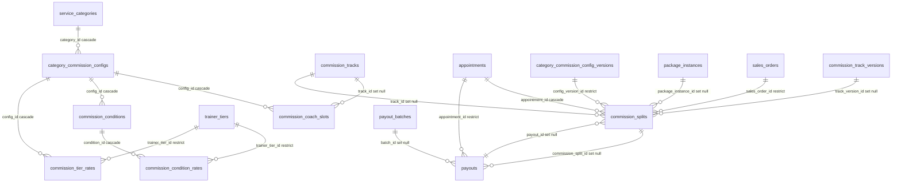
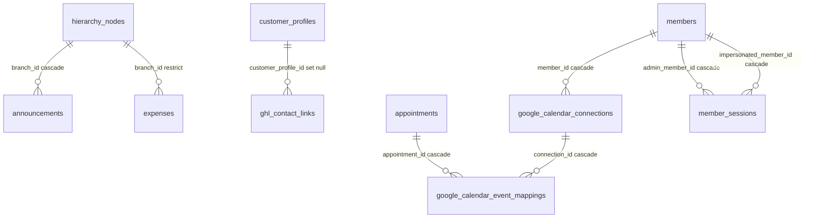
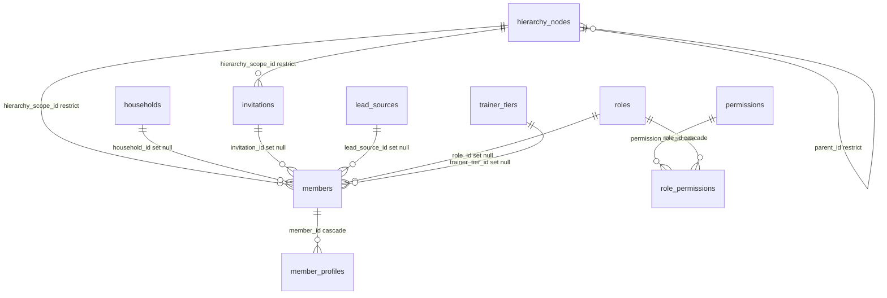
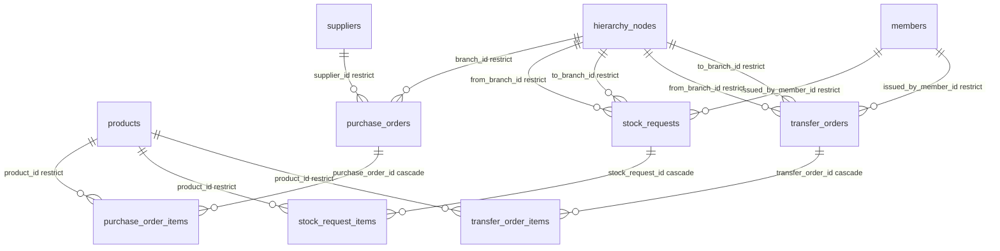
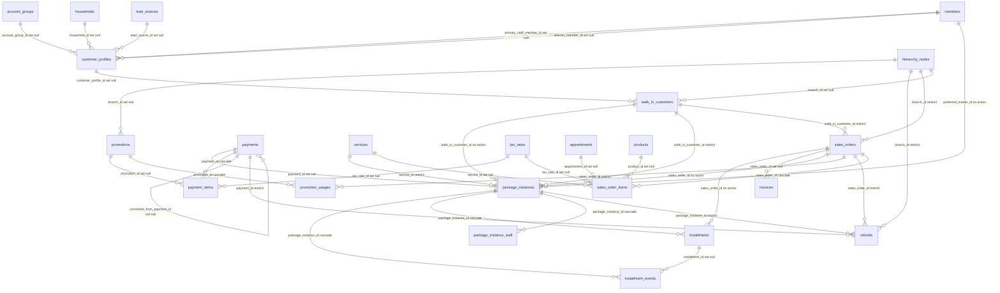
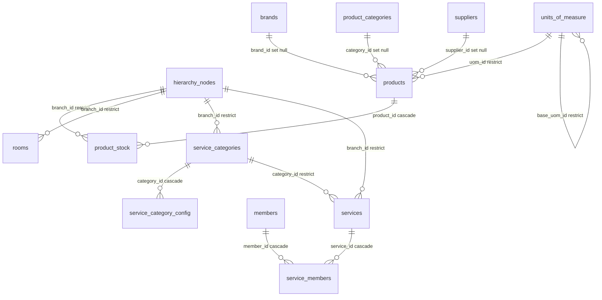

# Schema ERD (auto-generated)

> **Do not edit by hand.** Regenerate with `bun scripts/gen-erd.ts`.

Generated: 2026-06-12T11:13:01.191Z
Tenant org: Plan F.3.5 Global Billing Test Org
Control panel: 29 tables, 30 FKs
Tenant: 104 tables, 179 FKs

## Control Panel

```mermaid
erDiagram
  user ||--o{ account : "user_id cascade"
  admin_sessions ||--o{ admin_session_actions : "admin_session_id cascade"
  organizations ||--o{ admin_session_actions : "target_organization_id set null"
  user ||--o{ admin_sessions : "admin_user_id cascade"
  user ||--o{ admin_sessions : "impersonated_user_id cascade"
  organizations ||--o{ admin_sessions : "organization_id set null"
  organizations ||--o{ ghl_branch_links : "organization_id cascade"
  user ||--o{ invitation : "inviter_id cascade"
  organization ||--o{ invitation : "organization_id cascade"
  organization ||--o{ member : "organization_id cascade"
  user ||--o{ member : "user_id cascade"
  organizations ||--o{ org_country_stripe_accounts : "organization_id cascade"
  organizations ||--o{ organization_analytics : "organization_id cascade"
  organizations ||--o{ organization_branches : "organization_id cascade"
  organizations ||--o{ organization_members : "organization_id cascade"
  user ||--o{ organization_members : "user_id cascade"
  user ||--o{ organizations : "owner_user_id no action"
  subscriptions ||--o{ organizations : "subscription_id set null"
  organizations ||--o{ payment_drift_log : "organization_id set null"
  reconciliation_runs ||--o{ payment_drift_log : "run_id cascade"
  user ||--o{ platform_admins : "granted_by set null"
  user ||--o{ platform_admins : "user_id cascade"
  organizations ||--o{ platform_dispute_queue : "organization_id cascade"
  organizations ||--o{ reconciliation_state : "organization_id cascade"
  user ||--o{ session : "user_id cascade"
  organizations ||--o{ tenant_deletions : "organization_id cascade"
  organizations ||--o{ tenant_feature_overrides : "organization_id cascade"
  organizations ||--o{ tenant_notes : "organization_id cascade"
  organizations ||--o{ tenant_tags : "organization_id cascade"
  organizations ||--o{ tenant_usage_snapshots : "organization_id cascade"
```

Tables: account, admin_session_actions, admin_sessions, comms_templates, ghl_branch_links, invitation, member, org_country_stripe_accounts, organization, organization_analytics, organization_branches, organization_members, organizations, payment_drift_log, platform_admins, platform_dispute_queue, platform_payment_ledger, processed_webhook_events, reconciliation_runs, reconciliation_state, session, subscriptions, tenant_deletions, tenant_feature_overrides, tenant_notes, tenant_tags, tenant_usage_snapshots, user, verification

## Tenant — by domain

### Appointments & Scheduling

**Tables**: appointment_clients, appointment_staff, appointments, check_ins, class_slots, coach_intake_availability, coach_intake_exceptions, member_category_buffer_overrides, member_service_buffer_overrides, preferred_times, recurrence_rules, trainer_availability, waitlist_entries

```mermaid
erDiagram
  appointments ||--o{ appointment_clients : "appointment_id cascade"
  package_instances ||--o{ appointment_clients : "package_instance_id set null"
  walk_in_customers ||--o{ appointment_clients : "walk_in_customer_id restrict"
  walk_in_customers ||--o{ appointment_clients : "walk_in_customer_id no action"
  appointments ||--o{ appointment_staff : "appointment_id cascade"
  hierarchy_nodes ||--o{ appointments : "branch_id restrict"
  class_slots ||--o{ appointments : "class_slot_id set null"
  category_commission_config_versions ||--o{ appointments : "config_version_id no action"
  package_instances ||--o{ appointments : "package_instance_id set null"
  appointments ||--o{ appointments : "recurring_parent_id cascade"
  rooms ||--o{ appointments : "room_id set null"
  sales_orders ||--o{ appointments : "sales_order_id set null"
  services ||--o{ appointments : "service_id set null"
  members ||--o{ appointments : "trainer_id set null"
  appointment_clients ||--o{ check_ins : "appointment_client_id set null"
  hierarchy_nodes ||--o{ check_ins : "branch_id restrict"
  package_instances ||--o{ check_ins : "package_instance_id set null"
  hierarchy_nodes ||--o{ class_slots : "branch_id restrict"
  members ||--o{ class_slots : "instructor_id set null"
  services ||--o{ class_slots : "service_id cascade"
  members ||--o{ coach_intake_availability : "trainer_id cascade"
  members ||--o{ coach_intake_availability : "trainer_id cascade"
  members ||--o{ coach_intake_exceptions : "trainer_id cascade"
  members ||--o{ coach_intake_exceptions : "trainer_id cascade"
  service_categories ||--o{ member_category_buffer_overrides : "category_id cascade"
  members ||--o{ member_category_buffer_overrides : "member_id cascade"
  members ||--o{ member_service_buffer_overrides : "member_id cascade"
  services ||--o{ member_service_buffer_overrides : "service_id cascade"
  package_instances ||--o{ preferred_times : "package_instance_id cascade"
  appointments ||--o{ recurrence_rules : "appointment_id cascade"
  members ||--o{ trainer_availability : "trainer_id cascade"
  appointments ||--o{ waitlist_entries : "appointment_id set null"
  class_slots ||--o{ waitlist_entries : "class_slot_id cascade"
  customer_profiles ||--o{ waitlist_entries : "customer_profile_id cascade"
  members ||--o{ waitlist_entries : "member_id cascade"
  walk_in_customers ||--o{ waitlist_entries : "walk_in_customer_id cascade"
```

### Commission & Payouts

**Tables**: category_commission_configs, commission_coach_slots, commission_condition_rates, commission_conditions, commission_splits, commission_tier_rates, payouts

### Engagement & Integrations

**Tables**: announcements, audit_logs, dashboard_snapshots, expenses, ghl_contact_links, ghl_sync_events, ghl_user_links, google_calendar_connections, google_calendar_event_mappings, member_sessions, notification_preferences, notifications, user_activity_log

### Identity & Hierarchy

**Tables**: hierarchy_nodes, invitations, member_profiles, members, organization_settings, permissions, role_permissions, roles, trainer_tiers

### Inventory Ops

**Tables**: purchase_order_items, purchase_orders, stock_request_items, stock_requests, transfer_order_items, transfer_orders

### Misc

**Tables**: account_groups, announcement_scopes, appointment_status_history, branch_details, branch_stats_cache, category_commission_config_versions, commission_cycle_configs, commission_split_reversals, commission_track_rates, commission_track_versions, commission_tracks, credit_point_ledger, goods_receipt_items, goods_receipts, households, lead_sources, membership_holds, package_instance_status_history, payment_status_history, payout_batches, product_prices, push_tokens, refund_items, sales_order_status_history, scheduled_reports, service_prices, stock_movements, supplier_invoices, trainer_availability_exceptions

```mermaid
erDiagram
  announcements ||--o{ announcement_scopes : "announcement_id cascade"
  hierarchy_nodes ||--o{ announcement_scopes : "branch_id cascade"
  appointments ||--o{ appointment_status_history : "appointment_id cascade"
  hierarchy_nodes ||--o{ branch_details : "node_id cascade"
  hierarchy_nodes ||--o{ branch_stats_cache : "hierarchy_node_id cascade"
  service_categories ||--o{ category_commission_config_versions : "category_id cascade"
  hierarchy_nodes ||--o{ commission_cycle_configs : "branch_id cascade"
  payouts ||--o{ commission_split_reversals : "payout_adjustment_id set null"
  refunds ||--o{ commission_split_reversals : "refund_id restrict"
  commission_split_reversals ||--o{ commission_split_reversals : "reversed_by_reversal_id set null"
  commission_splits ||--o{ commission_split_reversals : "reversed_split_id restrict"
  trainer_tiers ||--o{ commission_track_rates : "tier_id restrict"
  commission_tracks ||--o{ commission_track_rates : "track_id cascade"
  commission_tracks ||--o{ commission_track_versions : "track_id cascade"
  service_categories ||--o{ commission_tracks : "category_id restrict"
  goods_receipts ||--o{ goods_receipt_items : "goods_receipt_id cascade"
  products ||--o{ goods_receipt_items : "product_id restrict"
  purchase_order_items ||--o{ goods_receipt_items : "purchase_order_item_id restrict"
  hierarchy_nodes ||--o{ goods_receipts : "branch_id restrict"
  purchase_orders ||--o{ goods_receipts : "purchase_order_id restrict"
  customer_profiles ||--o{ households : "primary_contact_profile_id set null"
  members ||--o{ membership_holds : "member_id set null"
  package_instances ||--o{ membership_holds : "package_instance_id cascade"
  package_instances ||--o{ package_instance_status_history : "package_instance_id cascade"
  payments ||--o{ payment_status_history : "payment_id cascade"
  hierarchy_nodes ||--o{ payout_batches : "branch_id set null"
  hierarchy_nodes ||--o{ product_prices : "branch_id cascade"
  products ||--o{ product_prices : "product_id cascade"
  package_instances ||--o{ refund_items : "package_instance_id set null"
  refunds ||--o{ refund_items : "refund_id cascade"
  sales_order_items ||--o{ refund_items : "sales_order_item_id set null"
  sales_orders ||--o{ sales_order_status_history : "sales_order_id cascade"
  hierarchy_nodes ||--o{ service_prices : "branch_id cascade"
  services ||--o{ service_prices : "service_id cascade"
  hierarchy_nodes ||--o{ stock_movements : "branch_id restrict"
  products ||--o{ stock_movements : "product_id cascade"
  goods_receipts ||--o{ supplier_invoices : "goods_receipt_id set null"
  purchase_orders ||--o{ supplier_invoices : "purchase_order_id set null"
  suppliers ||--o{ supplier_invoices : "supplier_id restrict"
  members ||--o{ trainer_availability_exceptions : "trainer_id cascade"
```

### Sales & Payments

**Tables**: customer_profiles, installment_events, installment_plans, installments, invoices, package_instance_staff, package_instances, payment_items, payments, promotion_usages, promotions, refunds, sales_order_items, sales_orders, tax_rates, walk_in_customers

### Services & Catalog

**Tables**: brands, product_categories, product_stock, products, rooms, service_categories, service_category_config, service_members, services, suppliers, units_of_measure

### Standalone (no FKs)

- audit_logs
- credit_point_ledger
- dashboard_snapshots
- ghl_sync_events
- ghl_user_links
- installment_plans
- notification_preferences
- notifications
- organization_settings
- push_tokens
- scheduled_reports
- user_activity_log

## Logical Text-Column Refs (no pg_constraint)

Detected via comment hints + naming conventions. Not enforced at DB level.

| Child | Col | → | Target | Source |
|---|---|---|---|---|
| account_groups | name | → | user.id | comment |
| account_groups | primary_user_id | → | user.id (CP) | convention |
| admin_session_actions | target_user_id | → | user.id (CP) | convention |
| announcements | created_by | → | members.userId (text) | convention |
| appointment_staff | staff_id | → | members.userId | comment |
| appointments | created_by | → | members.userId | comment |
| appointments | user_id | → | user.id (CP) | convention |
| audit_logs | actor_user_id | → | members.userId | comment |
| branch_details | pic_user_id | → | user.id (CP) | convention |
| brands | created_by | → | members.userId (text) | convention |
| category_commission_config_versions | created_by | → | members.userId (text) | convention |
| check_ins | client_id | → | members.userId (text) | convention |
| check_ins | client_type | → | members.userId | comment |
| commission_split_reversals | created_by | → | members.userId | comment |
| commission_splits | approved_by | → | members.userId | comment |
| commission_splits | created_by_user_id | → | user.id (CP) | convention |
| commission_splits | paid_by | → | members.userId | comment |
| commission_splits | staff_id | → | members.userId | comment |
| comms_templates | created_by_user_id | → | user.id (CP) | convention |
| credit_point_ledger | actor_user_id | → | user.id (CP) | convention |
| credit_point_ledger | customer_user_id | → | user.id (CP) | convention |
| expenses | approved_by | → | members.userId (text) | convention |
| ghl_user_links | ghl_user_id | → | user.id (CP) | convention |
| ghl_user_links | user_id | → | user.id (CP) | convention |
| households | created_by | → | members.userId (text) | convention |
| invitations | invited_by | → | users.id | comment |
| invoices | created_by | → | members.userId | comment |
| invoices | customer_id | → | members.userId | comment |
| member_sessions | admin_user_id | → | user.id (CP) | convention |
| member_sessions | impersonated_user_id | → | user.id (CP) | convention |
| members | user_id | → | users.id | comment |
| membership_holds | created_by | → | members.userId (text) | convention |
| notification_preferences | user_id | → | user.id (CP) | convention |
| notifications | user_id | → | user.id (CP) | convention |
| package_instance_staff | assigned_by | → | user.id | comment |
| package_instance_staff | staff_id | → | members.userId | comment |
| package_instances | approved_by | → | members.userId (text) | convention |
| package_instances | assigned_trainer_assigned_by | → | members.userId (text) | convention |
| payments | customer_id | → | members.userId | comment |
| payments | user_id | → | user.id | comment |
| payout_batches | created_by | → | members.userId | comment |
| payouts | manual_payout_confirmed_by | → | members.userId | comment |
| payouts | recipient_id | → | members.userId | comment |
| product_categories | created_by | → | members.userId (text) | convention |
| products | created_by | → | members.userId (text) | convention |
| promotions | created_by | → | members.userId (text) | convention |
| purchase_orders | approved_by | → | members.userId (text) | convention |
| purchase_orders | created_by | → | members.userId (text) | convention |
| push_tokens | user_id | → | user.id (CP) | convention |
| refunds | customer_id | → | member.userId | comment |
| refunds | processed_by | → | members.userId | comment |
| refunds | requested_by | → | members.userId | comment |
| refunds | reviewed_by | → | members.userId | comment |
| sales_orders | customer_name | → | member.userId | comment |
| sales_orders | lead_source_user_id | → | user.id (CP) | convention |
| scheduled_reports | created_by | → | members.userId (text) | convention |
| service_categories | created_by | → | members.userId (text) | convention |
| services | created_by | → | members.userId (text) | convention |
| stock_movements | actor_user_id | → | user.id (CP) | convention |
| tenant_deletions | requested_by | → | members.userId (text) | convention |
| tenant_feature_overrides | set_by_user_id | → | user.id (CP) | convention |
| tenant_notes | author_user_id | → | user.id (CP) | convention |
| tenant_tags | created_by_user_id | → | user.id (CP) | convention |
| trainer_availability_exceptions | created_by | → | members.userId (text) | convention |
| user_activity_log | user_id | → | user.id (CP) | convention |
| waitlist_entries | user_id | → | user.id (CP) | convention |
| walk_in_customers | created_by | → | members.userId (text) | convention |

## Drift Report

### Schema declares FK, live missing (0)

_None_

### onDelete action mismatch (0)

_None_

### Live has FK, schema doesn't declare — UNEXPECTED (0)

_None_

### Live FKs intentionally migration-only (4)

Declared via raw migration to avoid Drizzle circular imports. Tracked in `INTENTIONAL_MIGRATION_ONLY_FKS` in `scripts/gen-erd.ts`.

| Child | Col | → | Parent | Action |
|---|---|---|---|---|
| commission_split_reversals | reversed_by_reversal_id | → | commission_split_reversals | SET NULL |
| commission_splits | payout_id | → | payouts | SET NULL |
| households | primary_contact_profile_id | → | customer_profiles | SET NULL |
| refunds | payment_id | → | payments | RESTRICT |

### Tables in live, not in schema source (0)

_None_

### Tables in schema source, not in live (0)

_None_

