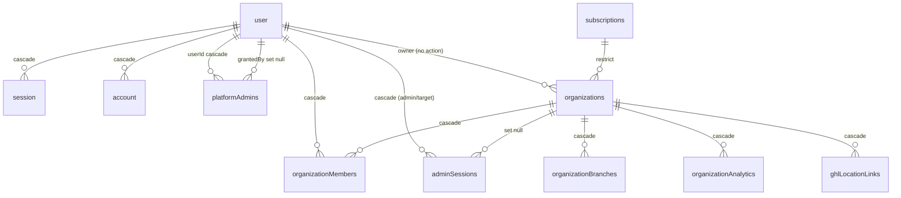
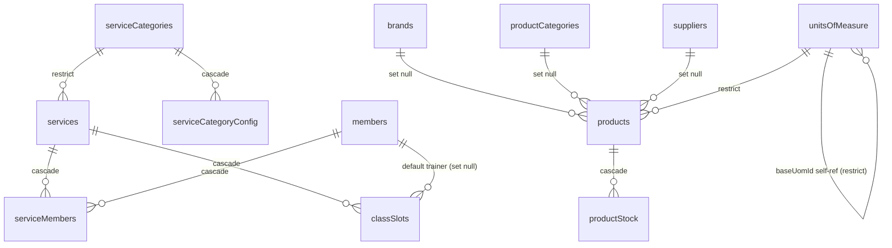
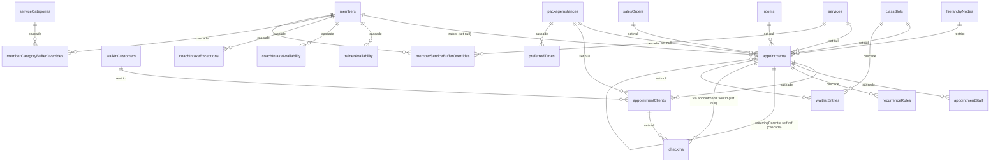
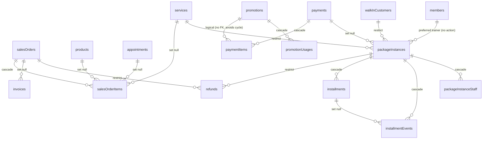
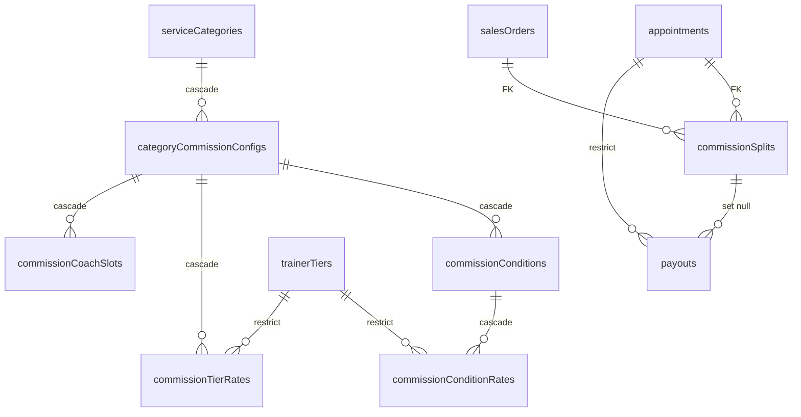
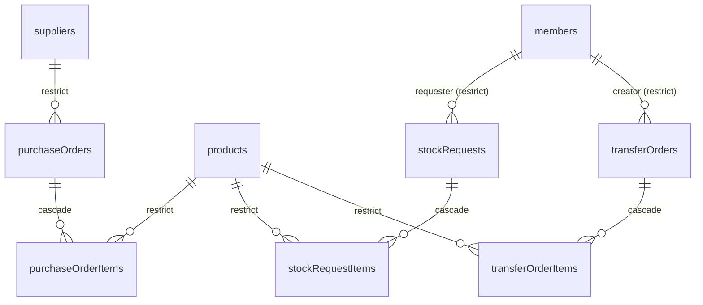
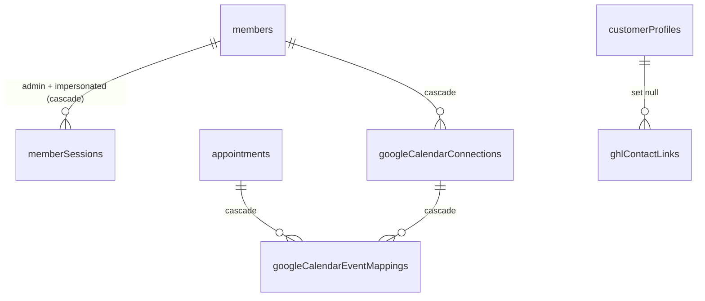

# Schema ERD

> **Prefer [schema-erd-auto.md](schema-erd-auto.md)** — auto-generated from live DB + schema source via `bun scripts/gen-erd.ts`. This hand-curated doc may drift; the auto doc cannot.


Auto-derived from `packages/db/src/schema/` FK declarations. Two physical DBs (control-panel + tenant-per-org). Cross-DB refs are **logical only** (text columns, no FK constraint).

Conventions:
- `||--o{` = one-to-many
- `||--||` = one-to-one
- `}o--o{` = many-to-many (via join table — shown as two 1-N to the join)
- All FK actions noted: `cascade` / `set null` / `restrict`

---

## 1. Control Panel DB

Auth + tenant metadata. Shared across all orgs.



**Tables**: `user`, `session`, `account`, `verification`, `organizations`, `organizationMembers`, `organizationBranches`, `organizationAnalytics`, `subscriptions`, `platformAdmins`, `adminSessions`, `ghlLocationLinks`.

---

## 2. Tenant — Identity & Hierarchy

Root of every tenant. `hierarchyNodes` = tree (regions → districts → branches). `members` scoped to a node.

```mermaid
erDiagram
  hierarchyNodes ||--o{ hierarchyNodes : "parent_id self-ref (restrict)"
  hierarchyNodes ||--o{ members : "scope (restrict)"
  hierarchyNodes ||--o{ invitations : "restrict"
  hierarchyNodes ||--o{ rooms : "restrict"
  hierarchyNodes ||--o{ services : "branch (restrict)"
  hierarchyNodes ||--o{ serviceCategories : "branch (restrict)"
  hierarchyNodes ||--o{ classSlots : "restrict"
  hierarchyNodes ||--o{ checkIns : "restrict"
  hierarchyNodes ||--o{ expenses : "restrict"
  hierarchyNodes ||--o{ announcements : "cascade"
  hierarchyNodes ||--o{ salesOrders : "restrict"
  hierarchyNodes ||--o{ refunds : "restrict"
  hierarchyNodes ||--o{ purchaseOrders : "restrict"
  hierarchyNodes ||--o{ stockRequests : "from/to (restrict)"
  hierarchyNodes ||--o{ transferOrders : "from/to (restrict)"
  hierarchyNodes ||--o{ productStock : "restrict"
  hierarchyNodes ||--o{ promotions : "branch (set null)"
  hierarchyNodes ||--o{ walkInCustomers : "branch (set null)"

  members ||--|| memberProfiles : "cascade"
  trainerTiers ||--o{ members : "set null"
  roles ||--o{ rolePermissions : "cascade"
  permissions ||--o{ rolePermissions : "cascade"
```



**Cross-DB logical refs** (no FK):
- `members.userId` (text) → `user.id` in control panel
- `organizationMembers.userId/organizationId` (text) → control panel
- `partnerStripeAccounts.partnerId` (text) → `members.userId` (was FK, removed — see MEMORY.md)

---

## 3. Tenant — Services & Catalog



---

## 4. Tenant — Appointments & Scheduling



---

## 5. Tenant — Sales, Payments, Packages



NOTE: `payments` has no FK to `appointments` (kept as plain column to avoid Drizzle TS7022 circular type).

**Logical refs in this domain (no FK constraint, enforced via migration or service layer):**
- `refunds.paymentId` → `payments.id`
- `invoices.paymentId` → `payments.id`
- `payments.invoiceId` → `invoices.id`
- `paymentItems.promotionId` → `promotions.id`
- `appointments.createdBy` → `members.userId` (text)

---

## 6. Tenant — Commission & Payouts



---

## 7. Tenant — Inventory Ops



---

## 8. Tenant — Customers, Sessions, Engagement



Standalone (no internal FKs in tenant): `notifications`, `notificationPreferences`, `auditLogs`, `userActivityLog`, `dashboardSnapshots`, `ghlSyncEvents`, `organizationSettings`, `taxRates`, `partnerStripeAccounts`, `installmentPlans`.

---

## Cross-DB Logical Refs (no constraint)

| From (tenant)                  | Column          | → To (control-panel)   | Notes                              |
| ------------------------------ | --------------- | ---------------------- | ---------------------------------- |
| `members`                      | `userId`        | `user.id`              | text col, indexed unique           |
| `invitations`                  | `invitedBy`     | `user.id`              | text                               |
| `partnerStripeAccounts`        | `partnerId`     | `members.userId`       | text, FK removed (unique idx only) |
| `auditLogs`                    | `userId`        | `user.id`              | text                               |
| `customerProfiles`             | `userId`        | `user.id`              | text, optional                     |
| `appointments`                 | `createdBy`     | `members.userId`       | text                               |

---

## Live DB Drift (verified 2026-05-05)

Verified against live tenant DB for org `Test Fitness Franchise` (`996febce-...`) via `scripts/dump-tenant-fks.ts`. 77 tables, 104 FKs.

### Drift: schema ahead of live (FK declared but missing in DB)

| Schema FK | Live state | File |
|---|---|---|
| `package_instances.preferred_trainer_id → members.id` | FK absent | `tenant/package-instances.ts:64` |

### Drift: live action differs from schema

| FK | Schema onDelete | Live onDelete |
|---|---|---|
| `appointment_clients.walk_in_customer_id → walk_in_customers` | `restrict` | `NO ACTION` |
| `package_instances.walk_in_customer_id → walk_in_customers` | `restrict` | `NO ACTION` |

### Drift: live ahead of schema (table/FK present but not in source)

| Live | Status |
|---|---|
| `ghl_user_links` table | No matching schema file — orphan from removed feature, drop or restore |

### Control Panel drift

| Live | Schema |
|---|---|
| `ghl_branch_links` table | Renamed to `ghl_location_links` in `control-panel/ghl-location-links.ts:18` — migration not applied |

### Action items

1. Generate + apply migration to add `preferred_trainer_id` FK
2. Generate + apply migration to fix two `walk_in_customer_id` actions (`NO ACTION` → `restrict`)
3. Decide: drop `ghl_user_links` or restore to schema
4. Apply rename migration `ghl_branch_links` → `ghl_location_links` in control panel

## Regen

When schema changes, regen via:

```bash
# Re-run grep, paste output, update this doc
rg "\.references\(\(\) =>" packages/db/src/schema -n
```

Or use `bunx drizzle-kit studio` for live FK browsing (one DB at a time).
